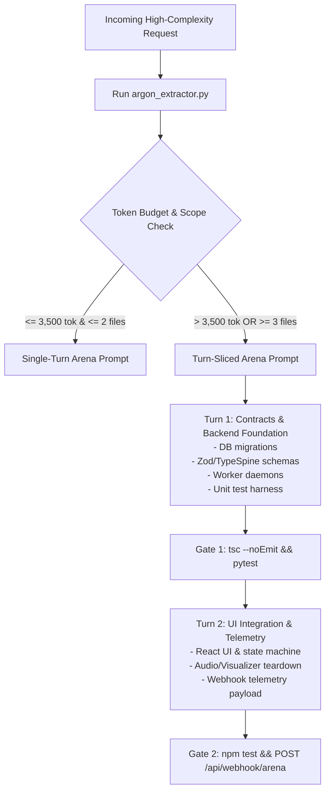

# Argon Frontier Model Prompt Templates & Invariants

This guide defines the official prompt engineering specifications for LM Arena Agentic Mode and 64k context models (Argon, Gemini 4 Argon High, DeepSeek v4.1).

---

## 1. The Frontier Model Trigger Engine (LM Arena Routing)

LM Arena Agentic mode does NOT allocate top-tier frontier models based on prompt hype. Prompting with phrases like *"Act as a world-class engineer"* or *"Use your smartest model"* triggers Arena's **Steerability Penalty**, which results in session downgrades to lightweight models.

Instead, the LM Arena backend routes models based on **Structural Task Complexity**:
1. **Zero Steerability Bait**: Maintain pure, high-density, professional technical language.
2. **Cross-Boundary Breadth**: Package tasks spanning multiple architectural tiers (e.g., Client React component + Daemon WebSocket handler + PostgreSQL RLS migration).
3. **Non-Negotiable Sandbox Invariants**: Concrete, deterministic constraints that lightweight models fail (e.g., strict TypeScript type checking, monotonic state progression, idempotent retry logic).
4. **Concrete Verification Commands**: Commands executable in the container (`tsc --noEmit`, `npm test`, `pytest`/`unittest`).
5. **Zero Scatter Mandate**: The entire assignment must be delivered in **EXACTLY ONE COPYABLE BLOCK**.

---

## 2. Turn-Slicing Protocol (< 3,500 Token Budget)

Argon operates with a 64k context window, but its generation sweet spot is bounded by **4,096 - 8,192 output tokens** and **8k-24k internal reasoning (CoT) tokens**.

When an assignment requires generating over 300 lines of implementation across multiple boundaries, Antigravity MUST slice the prompt into two sequential turns:



### Turn 1 Directive:
- Implements: Database DDL, backend data access layer, type definitions, and core domain business logic.
- Verifies: `(cd web && npx tsc --noEmit)` and `(cd agent-worker && .venv/bin/python -m unittest discover -s tests)`.

### Turn 2 Directive:
- Implements: Client components, UI state machine (empty, skeleton, error, active), and telemetry hooks.
- Verifies: `npm test` and `curl -sS -X POST http://localhost:4000/api/webhook/arena`.

---

## 3. Canonical Single-Block Templates

### Template A: Real-Time Telephony, WebRTC & Worker Concurrency

````markdown
### Target Repository & Branch
- Repository: `<github-org>/<repo-name>` (`main`)
- Active Branch: `<working-branch>`

### Architecture & Cross-Boundary Context
Multi-tenant real-time voice and streaming architecture spanning three boundaries:
1. **Voice Daemon (`<path-to-worker>`):** Handles connection lifecycle, VAD speech events, and ordered shutdown teardown.
2. **PostgreSQL Migrations (`<path-to-migration>`):** Enforces tenant isolation, call logging, and recording state constraints (`ok`, `failed`, `skipped`).
3. **Client Audio View (`<path-to-client-ui>`):** Manages WebRTC track subscription, visualizer RAF loops, and unmount cleanup.

### Active File Tree & Interface Contracts
- `<file1>`: `<exported symbols>`
- `<file2>`: `<exported symbols>`

### Extracted Type Spine & Contracts
```<lang>
// Extracted via scripts/argon_extractor.py
```

### Objective & Deep Concurrency Scope
[Concise description of the race condition, leak, or feature to implement across boundaries]

### Non-Negotiable Acceptance & Sandbox Constraints
1. Must guarantee atomic teardown under connection failure or unexpected disconnect.
2. Zero type escapes (must pass `tsc --noEmit` with zero errors).
3. Accompanied by regression tests exercising edge cases.
4. Run all verification commands:
   - `(cd web && npx tsc --noEmit)`
   - `npm test`
   - `(cd agent-worker && .venv/bin/python -m unittest discover -s tests)`

### Required Final Output: Cockpit Arena Evaluation Payload
Conclude your final response with the exact JSON payload formatted for `POST http://localhost:4000/api/webhook/arena`:
```json
{
  "model": "<evaluated-model-name>",
  "category": "<task-category>",
  "score": 0.0,
  "verdict": "<PASS/FAIL with exact observed findings>",
  "experience": "<files modified, invariants verified, and command exit codes>",
  "snippet": "<core hardened logic snippet>"
}
```
````

---

### Template B: High-Fidelity UI & Design System

````markdown
### Target Repository & Branch
- Repository: `<github-org>/<repo-name>` (`main`)

### Architecture & Design System Tokens
Warm editorial aesthetic adhering strictly to design system tokens:
- **Design Tokens**:
  ```css
  :root {
    --bg: #FAF7F2;
    --panel: #fffdf9;
    --text: #1C1512;
    --muted: #6E6259;
    --border: rgba(44, 34, 28, 0.12);
    --a: #7C3AED;
  }
  ```
- **Rules**: Zero magic hex values or generic Tailwind slop (`bg-blue-500`, `rounded-md`). Use established CSS variables and radius tokens (`--r-md`, `--r-lg`).

### Active Component Tree & State Contracts
- `<component-path>`: Component definition & 5-state matrix (empty, skeleton, error, stale, submitting).
- `<schema-path>`: Zod validation contracts.

### Extracted Type Spine
```typescript
// Extracted via scripts/argon_extractor.py
```

### Objective & UI State Modeling Scope
[Describe layout, responsive viewports (390px mobile, 768px tablet, 1440px desktop), and state transitions]

### Non-Negotiable Acceptance Constraints
1. Layout must adapt cleanly across viewports with zero horizontal scroll or layout shift.
2. All interactive elements must maintain WCAG 2.2 AA contrast and keyboard tab order.
3. Verification:
   - `(cd web && npx tsc --noEmit)`
   - `npm test`

### Required Final Output: Cockpit Arena Evaluation Payload
```json
{
  "model": "<model-name>",
  "category": "<ui-category>",
  "score": 0.0,
  "verdict": "<summary>",
  "experience": "<responsive checks and tsc status>",
  "snippet": "<component JSX snippet>"
}
```
````

---

### Template C: Dual-Runtime Parity & Database RLS Security

````markdown
### Target Repository & Branch
- Repository: `<github-org>/<repo-name>` (`main`)

### Architecture & Security Boundary
Multi-tenant isolation and mathematical parity spanning Python runtime and TypeScript client:
1. **Calculation Parity**: Mathematical operations (e.g. currency rounding, midpoint brackets) must yield identical outcomes in Python (`round` half-to-even) and TypeScript (`Math.round` half-up).
2. **PostgreSQL RLS**: Non-owner connection pool (`withUser(userId)`) must enforce tenant isolation; unauthenticated queries must return empty result sets without throwing.

### Extracted Type Spine & Schemas
```<lang>
// Extracted via scripts/argon_extractor.py
```

### Objective & Security Audit Scope
[Describe parity edge cases: negative numbers, non-finite floats, missing fields, and SQL injection prevention]

### Non-Negotiable Acceptance Constraints
1. Parity tests must assert equality across 100% of tested boundary inputs.
2. PostgreSQL RLS policies must prevent cross-tenant record leakage.
3. Verification:
   - `(cd web && npx tsc --noEmit)`
   - `npm test`
   - `(cd agent-worker && .venv/bin/python -m unittest discover -s tests)`

### Required Final Output: Cockpit Arena Evaluation Payload
```json
{
  "model": "<model-name>",
  "category": "dual-runtime-parity-and-rls",
  "score": 0.0,
  "verdict": "<PASS/FAIL summary>",
  "experience": "<test count output and modified files>",
  "snippet": "<parity math or RLS trigger snippet>"
}
```
````
