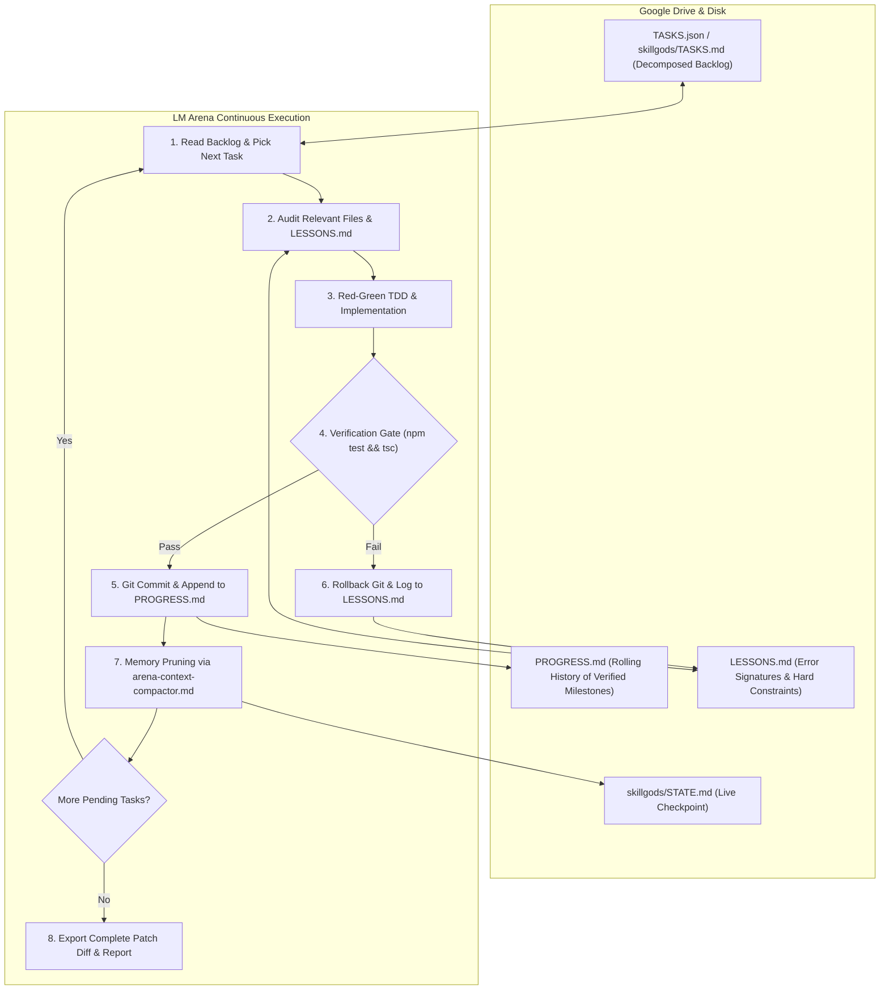

# Arena & Frontier Agent Prompt Architect

Use this skill whenever you need to prepare, steer, or verify tasks for **Frontier Coding Agents** on LM Arena (`arena.ai`), including **Claude Fable 5.2 (Max)**, **Claude Opus 5.5 (Max)**, **Gemini 4 Carbon (High)**, and **Gemini 4 Argon High**.

---

## 1. The Arena Routing Reality: How to Access Frontier-Tier Models

In blind evaluation modes ([Start Voting](https://arena.ai/) and [Agent Arena](https://arena.ai/leaderboard/agent)), the router uses **pre-read weighted random sampling** to keep benchmarks statistically unbiased ([Interaction-as-a-Judge](https://arena.ai/blog/interaction-as-a-judge/)). The router **does not inspect prompt difficulty** to award stronger models to harder tasks.

However, you can **narrow the eligible routing pool toward top-tier orchestrators** through capability gating, deterministic selection, and early-turn diagnostics:

### A. Capability Gating in Blind Agent Mode
Before sampling occurs, the router strictly enforces technical capability filters. Smaller, experimental, or older endpoints that lack required integrations are excluded from the pool:
1. **Enable Workspace Connectors**: Using external integrations ([Connectors in Agent Mode](https://arena.ai/blog/connectors-in-agent-mode/)) restricts the routing pool exclusively to models certified for complex multi-tool schemas and authenticated connector pipelines.
2. **Include Multimodal Inputs**: Attaching UI wireframes, system architecture diagrams, or error screenshots forces the router to drop text-only models and select orchestrators with native vision-to-code support.
3. **Provide Multi-File / Structured Archives**: Supplying a repository archive or multi-document context filters out endpoints with narrow context windows or weak file-system tool harnesses.

### B. Deterministic Selection (Bypassing Blind Routing)
When executing production work that cannot afford randomized model assignment:
- **Direct Model Selection**: Use [Choose any model](https://arena.ai/direct) to pick a specific flagship model directly (e.g., Claude Fable 5.2 Max, Claude Opus 5.5 Max, Gemini 4 Carbon). (Note: Direct sessions are excluded from public leaderboard rankings).
- **Side-by-Side Mode**: Use [Compare Models Side by Side](https://arena.ai/side-by-side) to run two explicitly chosen frontier models on the exact same prompt simultaneously.

### C. Early-Turn Diagnostics (The 60-Second Re-Roll Sentinel)
Because Agent Mode hides the model name, evaluate behavior during the **first two tool calls**:

| Diagnostic Signal | High / Max Orchestrator (Fable 5.2, Opus 5.5, Carbon) | Low / Medium Orchestrator (Astra Med, Terra, Low-tier) |
| :--- | :--- | :--- |
| **Initial Tooling** | Maps directory structure and reads configs/tests **before** writing code. | Immediately starts writing or overwriting files without checking dependencies. |
| **Context Hygiene** | Uses targeted searches (`grep`, `rg`, line-range reads) instead of dumping massive files. | Dumps entire lockfiles, giant files, or root trees into context. |
| **Error Handling** | Reads full stack traces, diagnoses root causes, and adjusts hypothesis. | Repeats nearly identical failing commands with minor syntax guesses. |
| **Hallucination** | Verifies file paths and CLI flags against disk first. | Hallucinates non-existent paths, options, or packages. |

> [!IMPORTANT]
> **The 60-Second Re-Roll Rule**: If a blind Agent session exhibits Low-tier thrashing in turns 1–2, **terminate the session immediately** and open a fresh session to re-roll the orchestrator. Do not burn time or tokens trying to rehabilitate a low-tier model on a complex multi-file codebase.

---

## 2. Mandatory 3-Phase Execution Protocol

Even when landing top models (Claude Fable 5.2 Max or Gemini 4 Carbon), a vague prompt causes the agent to burn thinking budget guessing requirements. Conversely, procedural micromanagement ("Step 1: edit file A, Step 2: add variable B") handcuffs the model.

Every prompt generated by this skill must enforce the **Mandatory 3-Phase Protocol**:

```markdown
## Objective
[State the exact deliverable, target system, and end-user behavior in 2–3 sentences.]

## Inputs & Attached Context
- Attached Artifact / Connector: [Reference uploaded screenshot, diagram, repo archive, or active Connector]
- Constraint: You must inspect and extract all specifications from the attached artifact/connector before proposing changes.

## Execution Protocol (Mandatory Phases)

### Phase 1: Environment Audit (Read-Only)
1. Inspect the workspace structure, package dependencies, and relevant existing modules using targeted search commands (do not dump lockfiles or build folders).
2. Identify potential edge cases, version conflicts, or architectural constraints.
3. Output a concise implementation plan mapping exact files to create or modify.
*Constraint: Do NOT write or edit any files until Phase 1 is complete.*

### Phase 2: Implementation
1. Implement the solution modularly, matching existing project conventions and strict typing.
2. Handle error states, input validation, and edge cases explicitly—no placeholder logic or TODO stubs.
3. You have full architectural ownership of internal implementation details, state machines, and concurrency patterns.

### Phase 3: Verification & Self-Correction
1. Run the build, type-checker, and test suite:
   - `(cd web && npx tsc --noEmit)`
   - `npm test`
   - `(cd agent-worker && .venv/bin/python -m unittest discover -s tests)`
2. If any command fails, analyze the full error trace, explain the root cause, and patch it cleanly.
3. Do not conclude until all verification checks pass with zero errors.
```

---

## 3. Mid-Session Steering Strategy (Interaction-as-a-Judge Optimization)

Arena tracks **Steerability, Confirmed Success, Bash Recovery, and Tool Hallucination**. When steering an agent mid-session:

1. **Replace Vague Pushback with Diagnostic Constraints**:
   - ❌ *Don't*: "That didn't work, fix it."
   - ✅ *Do*: "The build failed with `[exact error]` because `[module X]` expects `[type Y]`. Inspect `[file]` lines 40–80 before applying a patch."
2. **Explicitly Confirm Milestone Completion**:
   - When Phase 1 or Phase 2 succeeds, explicitly state: *"Phase 1 verified—proceed to Phase 2."*
   - This locks in the valid state and prevents the agent from second-guessing or rewriting working code.
3. **Isolate Failing Sub-Tasks**:
   - If the agent gets stuck on a complex integration, pause and instruct it: *"Write a standalone minimal reproduction script in `/tmp/test_repro.ts` to verify the behavior before touching the main codebase."*

---

## 4. Context Budget & Ground-Truth AST Type Spines

Even with models offering large context windows, dumping raw repository dumps into LM Arena causes attention dilution and container freezes.

Always run `scripts/argon_extractor.py` to extract minimal Type Spines (< 3,500 tokens):
- Strips implementation bodies to `...`.
- Retains exact Zod schemas, TypeScript interfaces, Python class structures, and SQL DDL.
- Injects CSS design tokens (`:root { ... }`) to eliminate generic styling hallucinations.

---

## 5. Reviewer AI Calibration & "Reason-First" Invariant

When reviewing code delivered from Arena:
1. **Frontier Capability Recognition**: Claude Fable 5.2 Max, Claude Opus 5.5 Max, and Gemini 4 Carbon operate with deep reasoning. Unconventional patterns are often deliberate optimizations (race condition prevention, zero-allocation memory paths, soundness guarantees).
2. **Reason-First Mandate**: Deducing *why* the model chose the pattern before flagging an issue.
3. **Definitive Bug Threshold**: Flag as a bug ONLY if `tsc --noEmit` fails, a test breaks, or an RLS/security boundary is violated.

---

## 6. Long-Running Autonomous Marathon Protocol (Multi-Hour Execution Harness)

Standard agents terminate prematurely after 30–60 minutes because single-session context bloats, hits token limits, or assumes completion after a single sub-task.

To achieve **4–8 hours of uninterrupted, continuous engineering** on LM Arena, the agent must be prompted to operate as an **Autonomous Epoch Loop** governed by persistent external memory files on disk and Google Drive (`skillgods`), supervised by Antigravity as the Chief Software Engineer.



### The Long-Running Marathon Prompt Template (Copy-Paste for LM Arena)

When launching a multi-hour autonomous session on LM Arena, use this exact prompt:

```markdown
## Objective: Long-Running Autonomous Marathon Execution
[State high-level goal, e.g.: "Implement the complete multi-tenant Feature Switchboard, Meta Ads Campaign Manager, and AI SEO (GEO) citation engine across database, API routes, and client portal."]

## Connected Environment & Tooling
- Integration: Google Drive Connector is active (Folder: `skillgods`).
- Mandatory Guides: Read `CHIEF_SOFTWARE_ENGINEER_CHECKLIST.md` and `arena-context-compactor.md` from Google Drive before beginning.
- Continuous Oversight: Antigravity Chief Software Engineer is monitoring outputs and validating test suites.

## Mandatory Autonomous Epoch Loop Protocol
You are running in Autonomous Marathon Mode. You are NOT permitted to stop after completing a single file or sub-task. You must execute continuous work cycles until the entire task backlog is 100% complete and verified.

### Epoch Step 1: Backlog Initialization (Turn 1)
1. Inspect the workspace and create/initialize `TASKS.json` in the root with 15–30 granular, sequential micro-tasks covering the entire objective.
2. Initialize `PROGRESS.md` and `LESSONS.md` on disk.
3. Update `skillgods/STATE.md` with the active mission plan.

### Epoch Step 2: The Continuous Execution Loop
For EACH task in `TASKS.json` with status `pending`:
1. **Targeted Read**: Read ONLY the specific files and tests needed for this task. Check `LESSONS.md` for known pitfalls.
2. **Red-Green TDD**: Write or update failing automated unit/integration tests first.
3. **Surgical Implementation**: Write the minimal typed production code to make the tests pass. No placeholders, no `as any`, no synthetic styling.
4. **Deterministic Verification Gate**:
   - Run: `(cd web && npx tsc --noEmit)`
   - Run: `npm test`
5. **On Verification Pass**:
   - Stage and commit: `git add . && git commit -m "feat([scope]): [task title]"`
   - Mark task as `completed` in `TASKS.json`.
   - Append a 2-line summary to `PROGRESS.md`.
6. **On Verification Fail**:
   - Revert dirty changes: `git checkout -- .`
   - Log the failure reason into `LESSONS.md` to prevent repeating it.
   - Adjust hypothesis and retry once.
7. **Attention Pruning (Context Compaction)**:
   - Search Google Drive for `arena-context-compactor.md`.
   - Prune intermediate terminal dumps from your active memory.
   - Update `skillgods/STATE.md`.
   - **DO NOT STOP**. Immediately proceed to the next pending task in `TASKS.json`.

### Epoch Step 3: Mission Completion & Final Deliverable
Only when ALL tasks in `TASKS.json` are marked `completed` and all tests pass (0 failures, 0 TypeScript errors):
1. Download the cumulative git patch: `git diff main...HEAD > marathon_deliverable.patch`.
2. Output the final summary report with total tasks completed, passing test count, and list of modified files.
```

---

## 7. How Antigravity Monitors & Steers the Arena Marathon

While LM Arena executes the multi-hour marathon, Antigravity functions as the **Senior Engineering Lead / Monitor**:

1. **Periodic Observation**: Antigravity uses the browser subagent to periodically inspect the Arena tab's HUD, output stream, and `skillgods/STATE.md` on Google Drive.
2. **Mid-Flight Steerability Injections**:
   - If the Arena model gets stuck on a syntax edge-case or flails, Antigravity sends a surgical 1-line diagnostic prompt:
     `[STEERING] Task 4 failed due to [exact root cause]. Review LESSONS.md line 12 and inspect web/src/lib/auth.ts lines 25-45.`
3. **Mid-Flight Compaction**:
   - If token bloat begins slowing down the Arena container after 6+ turns, Antigravity dispatches:
     `[COMPACT & RESUME] Execute arena-context-compactor.md, emit State Ledger, and proceed to Task 5.`
4. **Local Verification & Merge**:
   - When the marathon concludes, Antigravity pulls the patch, runs local security audits, validates all 234+ tests locally, and merges into `main`.

---

## Quick Reference Commands

- **Extract Type Spine**:
  ```bash
  python3 .agents/skills/argon-prompt/scripts/argon_extractor.py --files web/src/contracts/schemas.ts web/src/app/globals.css --max-tokens 3500
  ```
- **Inspect production templates**:
  Read [prompt_templates.md](./references/prompt_templates.md).
- **Inspect LMSYS router heuristics**:
  Read [router_heuristics_guide.md](./references/router_heuristics_guide.md).
