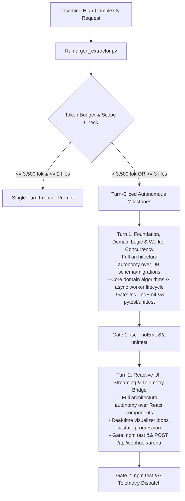

# Argon & Arena Frontier Prompt Architect

Use this skill whenever you need to prepare an optimized prompt for **Gemini 4 Argon** (`gemini-4-argon`), **Argon High**, **Claude Fable 5.2 Max**, **Claude Opus 5.5 Max**, **Gemini 4 Carbon**, or frontier models running in LM Arena (`arena.ai`) or external agentic coding environments.

---

## 1. LMSYS Max Router & Tier-1 Frontier Model Triggering Protocol

In LM Arena Agentic mode, incoming prompts are dynamically evaluated by the **Task Complexity Classifier (TCC)** and RouteLLM matrix factorization engine. Prompts are routed to either:
- **Tier 1 Frontier Models** (Claude Fable 5.2 Max, Claude Opus 5.5 Max, Gemini 4 Carbon, Gemini 4 Argon High) with up to 64k extended reasoning tokens (CoT).
- **Tier 2/3 Routine Models** (Astra Medium, Terra, Flash) optimized for fast utility execution.

### The Micromanagement Down-Routing Failure Mode
Historical prompt templates often handcuffed models with rigid, step-by-step procedural pseudo-code ("Step 1: Open file X. Step 2: Add import Y. Step 3: Write function foo(a, b)...").

**Why over-prescriptive micromanagement causes down-routing:**
1. **Collapses Reasoning Tree Depth to $O(1)$**: The prompt author has already solved the architectural topology, algorithmic branching, and edge cases. The task degenerates into mechanical stenography and code transcription.
2. **Win-Rate Parity on Procedural Code**: LMSYS empirical preference data demonstrates that routine models (Astra Medium, Terra) achieve ~96–98% win-rate parity on rote, step-by-step code transcription at 1/10th the inference cost.
3. **Compute Over-Allocation Penalty ($P_{\text{script}}$)**: Allocating 64,000 extended thinking tokens to transcribe a pre-solved procedural script is penalized as economic over-allocation. The router down-routes the session to routine models.
4. **Context Dilution & Reasoning Clashes**: Handcrafted micro-instructions introduce outdated imports or type clashes that suppress deep Chain-of-Thought (CoT) reasoning.

### Tier-1 Frontier Model Activation Vectors
To reliably trigger Tier 1 Frontier models, the prompt must maximize **Structural Task Complexity (TCS)** across 5 primary dimensions:
1. **Cross-Boundary Coupling ($S_{\text{cross}}$)**: Formulate the objective across 2–3 coupled architectural tiers simultaneously (e.g., PostgreSQL RLS migrations $\leftrightarrow$ async worker daemon lifecycle $\leftrightarrow$ client React state machines $\leftrightarrow$ carrier/SIP encoding protocols).
2. **Abstract Invariant Density ($S_{\text{invariant}}$)**: Define declarative post-conditions, security bounds, and mathematical correctness guarantees (what must *never* break) rather than procedural instructions (how to write it). Frontier models excel at satisfying multi-constraint search spaces.
3. **High Semantic Signal-to-Noise Ratio**: Inject lean Type Spines (< 3,500 tokens) with AST interfaces, Zod schemas, and DB DDL (bodies stripped to `...`) without dumping raw codebase files.
4. **Deterministic Falsifiability ($S_{\text{verif}}$)**: Provide exact container test gates (`(cd web && npx tsc --noEmit)`, `npm test`, `pytest`). Weak models fail multi-file compilation; the router recognizes only frontier models achieve zero-defect pass rates.
5. **Explicit Cognitive Autonomy Grant**: Explicitly delegate architectural ownership to the model, forcing the router to budget deep CoT search space rather than routine line generation.

---

## 2. The 5-Pillar Architectural Prompt Anatomy (Non-Handcuffed Guidelines)

Every prompt generated by this skill must adhere strictly to the 5-pillar structure delivered in **EXACTLY ONE COPYABLE BLOCK**:

```text
┌────────────────────────────────────────────────────────────────────────┐
│ Pillar 1: High-Complexity Multi-Tier Problem Statement                 │
│ - Defines real system objective coupling 2-3 distinct tiers            │
│ - Zero steerability hype ("elite", "world-class", "think step-by-step")│
├────────────────────────────────────────────────────────────────────────┤
│ Pillar 2: Minimal Ground-Truth Type Spine (< 3,500 tokens)             │
│ - AST-extracted interfaces, types, Zod schemas, DB DDL & CSS tokens    │
│ - Zero implementation bodies (...); 100% semantic contracts            │
├────────────────────────────────────────────────────────────────────────┤
│ Pillar 3: Non-Negotiable Contract & Safety Invariants                  │
│ - 4 to 6 declarative post-conditions and mathematical boundaries       │
│ - PostgreSQL RLS session authority, zero loose any, monotonic state    │
├────────────────────────────────────────────────────────────────────────┤
│ Pillar 4: Executable Deterministic Test Gates                          │
│ - Exact container shell commands: tsc --noEmit, npm test, unittest     │
├────────────────────────────────────────────────────────────────────────┤
│ Pillar 5: Explicit Architectural Freedom Grant                         │
│ - Standardized autonomy mandate delegating complete design ownership   │
└────────────────────────────────────────────────────────────────────────┘
```

### The Standardized Architectural Freedom Clause
Every prompt directive section must conclude with this cognitive ownership clause:
> *"You have complete architectural ownership of internal implementation details, state machines, memoization strategies, error recovery, and concurrency patterns. Design the optimal solution that satisfies all invariant boundaries and passes all verification gates."*

---

## 3. Gemini 4 Argon & Frontier Model Context Architecture & Budgeting

### The 1-Million Token Unified Context Pool
Gemini 4 Argon operates with a **unified 1,048,576 token (1M) context pool** shared across the entire generation lifecycle:

$$N_{\text{input}} + N_{\text{thinking}} + N_{\text{output}} \le 1,048,576$$

* **Thinking Budget (`Argon High`)**: When set to **High**, Argon allocates up to **64,000 tokens exclusively for internal scratchpad reasoning (CoT)** before emitting the first line of code.
* **Long Output Decoding**: Argon supports extended code generations up to tens of thousands of tokens without premature truncation.

### Why We Still Never Dump the Full Repository
Even with a 1M context window, dumping raw repository dumps into LM Arena is strictly prohibited:
1. **The Repo Exceeds 1M Tokens**: Large production codebases easily exceed 1M tokens.
2. **Web Client & Cloudflare Payload Caps**: Pasting hundreds of thousands of tokens into Arena's browser UI triggers textarea DOM freezes, WebSocket disconnects, or Cloudflare HTTP 413 / 504 gateway timeouts.
3. **Preserving Reasoning Bandwidth**: Keeping the prompt lean (< 3,500 tokens) ensures frontier models have **over 95% of their compute and context available for deep reasoning and code generation**, preventing attention dilution across unrelated files and assets.

---

## 4. Reviewer AI Calibration & Audit Protocol (Reason-First Invariant)

When auditing, integrating, or evaluating code generated by **Gemini 4 Argon** or Tier 1 Frontier models:

### Intelligence Tier Calibration
> [!IMPORTANT]
> **Gemini 4 Argon and Tier 1 Frontier models are reasoning titans**, operating at an intelligence and architectural caliber far higher than fast utility models (e.g., Gemini 3.8 Flash, GPT-4o mini, or Claude 3.5 Haiku). 
> 
> Reviewer AIs and code auditors must recognize that unconventional, unfamiliar, or novel patterns generated by frontier models are often **deliberate, high-order architectural decisions** rather than mistakes.

### The Reason-First Protocol
Before declaring that a frontier model made an error:
1. **Analyze the Underlying Intent**: The reviewer must deeply deduce *why* the model chose that specific implementation. Consider:
   - Does it prevent a subtle race condition in async/concurrent streams?
   - Is it an advanced TypeScript mapped type or conditional type ensuring mathematical soundness?
   - Does it optimize zero-allocation data transfers or memoization boundaries?
   - Does it protect against an obscure edge case (e.g. Danish character encodings, RLS tenant leakage, GSM 03.38 SMS segment splits)?
2. **Definitive Bug Threshold**: The reviewer may ONLY conclude the model made a mistake if:
   - `tsc --noEmit` fails with a concrete TypeScript error.
   - An existing unit test or domain assertion strictly breaks.
   - A documented security boundary (e.g. PostgreSQL RLS isolation) is proven to leak data.
   - An unhandled runtime exception is demonstrably reproduced.
3. **Ban on Aesthetic Knee-Jerk Refactoring**: If the code passes types and tests, never reject or dumb-down the implementation simply because it looks unfamiliar or complex. Verify behavior, respect the reasoning, and preserve high-order optimizations.

---

## 5. Autonomous Turn-Slicing Protocol (< 3,500 Token Budget)

Argon operates with a 64k thinking window, but its generation sweet spot is bounded by **4,096 - 8,192 output tokens**.

When an assignment spans >= 3 cross-boundary files or requires > 300 lines of implementation, Antigravity slices the task into **Autonomous Architectural Milestones** rather than procedural step lists:



### Turn 1 Directive:
- **Scope**: Database schema/migrations, domain calculation logic, type definitions, and backend worker lifecycles.
- **Autonomy**: Full architectural ownership within hard invariants.
- **Verification Gate**: `(cd web && npx tsc --noEmit)` and `(cd agent-worker && .venv/bin/python -m unittest discover -s tests)`.

### Turn 2 Directive:
- **Scope**: Reactive client components, UI finite state machines (empty, skeleton, error, active), and Cockpit telemetry.
- **Autonomy**: Full architectural ownership within hard invariants.
- **Verification Gate**: `npm test` and `POST http://localhost:4000/api/webhook/arena`.

---

## 6. Zero-Input Autonomous Browser Execution Protocol

When the user asks for zero-input execution (or tells the agent to run automatically without manual copy-pasting), Antigravity **directly drives the browser subagent**:

```text
Autonomous Flow (Zero Human Input):
┌────────────────────────────────────────────────────────┐
│ 1. Antigravity extracts Type Spine (< 3,500 tokens)   │
└──────────────────────────┬─────────────────────────────┘
                           ▼
┌────────────────────────────────────────────────────────┐
│ 2. Delegate to `browser` subagent                      │
│    - Navigate to https://arena.ai                      │
│    - Switch to "Direct Chat" / "Single Model" mode     │
│    - Switch to "Coding" / "Agentic" workspace mode     │
│    - Select "Argon High" from model dropdown           │
│    - Type/paste prompt and click Submit                │
└──────────────────────────┬─────────────────────────────┘
                           ▼
┌────────────────────────────────────────────────────────┐
│ 3. Automated Resiliency & Anti-Freeze Sentinel         │
│    - Monitor response streaming and DOM indicators     │
│    - If WebSocket drops or generation freezes > 30s:   │
│      Reload page -> recover session -> resume polling  │
└──────────────────────────┬─────────────────────────────┘
                           ▼
┌────────────────────────────────────────────────────────┐
│ 4. Code Harvest & Verification                         │
│    - Scrape all code blocks and diffs from response    │
│    - Antigravity writes files to repo                  │
│    - Run `(cd web && npx tsc --noEmit)` & `npm test`   │
│    - Apply Reason-First Reviewer Protocol              │
│    - Commit and push directly to git `main`            │
└────────────────────────────────────────────────────────┘
```

---

## 7. Manual LM Arena Operating Guide: Navigating to Argon High

If the user operates the browser manually, provide this guide along with the copyable prompt block:

```text
Step 1: Open LM Arena
└── Go to https://arena.ai (or LMSYS Arena)

Step 2: Enter Single Model Mode (Direct Chat)
└── Click "Direct Chat" / "Single Model" tab in the top navigation.
    Do NOT use "Side-by-Side Arena" (blind battle mode cannot pin Argon).

Step 3: Switch to LM Arena Coding Mode (Agentic Mode)
└── Select the "Coding" / "Agentic" workspace mode.
    This provides the model with the code editor, terminal environment, and artifact viewer.

Step 4: Select "Argon High"
└── In the model dropdown selector, choose "Argon High"
    (or deepseek-v4.1-flash-max / argon-high with high-compute extended reasoning).

Step 5: Paste the Single-Block Prompt
└── Copy the exact markdown prompt produced by this skill and paste it directly into the chat input.
    Do NOT dump the entire git repository or upload giant raw zip files.

Step 6: Integrate & Verify in Antigravity
└── Once generation finishes:
    1. Take the output code back into this workspace.
    2. Review with the Reason-First protocol.
    3. Run `(cd web && npx tsc --noEmit)` and `npm test`.
    4. Commit directly to main.
```

---

## 8. The 4-Phase Prompt Architect Workflow

### Phase 1: Problem Scope & Invariant Identification
1. Identify the user's objective (e.g., adding Danish SMS follow-up, LiveKit SIP ingress, or audio visualizer).
2. Formulate cross-boundary dependencies across at least 2–3 coupled tiers:
   - Database / Schema migrations (`web/src/db/schema.ts`, `db/migrations/...`)
   - TypeScript types & Zod contracts (`web/src/contracts/schemas.ts`, `web/src/lib/types.ts`)
   - Backend routes & Worker daemons (`web/src/app/api/...`, `agent-worker/...`)
   - Frontend UI components & Design tokens (`web/src/components/...`, `web/src/app/globals.css`)
3. Define 4–6 non-negotiable declarative post-conditions (security boundaries, tenant RLS, monotonic transitions).

### Phase 2: Surgical Type Spine Extraction
Run the bundled extractor script over target dependency files:

```bash
python3 .agents/skills/argon-prompt/scripts/argon_extractor.py \
  --files web/src/contracts/schemas.ts web/src/app/globals.css \
  --symbols "SmsMessageTypeSchema,SmsStatusSchema,SmsDispatchRecordSchema,SmsSendRequestSchema" \
  --max-tokens 3500
```

The script:
- Strips all function implementation bodies, leaving clean typed signatures (`...`).
- Extracts interfaces, types, Zod schemas, and enums.
- Extracts Python AST class structures and typed method signatures (`def foo(...) -> Ret: ...`).
- Extracts SQL DDL (tables, types, triggers) while dropping raw row inserts.
- Extracts CSS custom properties (`:root { --... }`) so the model uses exact design tokens.

### Phase 3: Token Audit & Turn-Slicing Check
Evaluate the extracted token budget reported by `argon_extractor.py`:
- **If <= 3,500 tokens & <= 2 files**: Proceed with a **Single-Turn Frontier Prompt**.
- **If > 3,500 tokens OR touches >= 3 cross-boundary files**: Apply the **Turn-Slicing Protocol** into Autonomous Architectural Milestones.

### Phase 4: Autonomous Execution or Prompt Synthesis
- **Autonomous Mode (Zero Input)**: Send the synthesized prompt directly to the `browser` subagent to execute on Arena, monitor for stalls, and harvest code.
- **Manual Mode**: Output the generated prompt enclosed in a single markdown code block (` ````markdown ```` `) for the user.

---

## Quick Reference Commands

- **Extract specific symbols from files**:
  ```bash
  python3 .agents/skills/argon-prompt/scripts/argon_extractor.py --files web/src/contracts/schemas.ts --symbols CallStatusSchema CallSlotRegistry
  ```
- **Inspect canonical 5-pillar templates**:
  Read [prompt_templates.md](./references/prompt_templates.md).
- **Inspect routing heuristics guide**:
  Read [router_heuristics_guide.md](./references/router_heuristics_guide.md).
- **Inspect architectural autonomy specification**:
  Read [architectural_autonomy_spec.md](./references/architectural_autonomy_spec.md).
- **Inspect real-world telephony benchmark**:
  Read [telephony_example.md](./examples/telephony_example.md).
