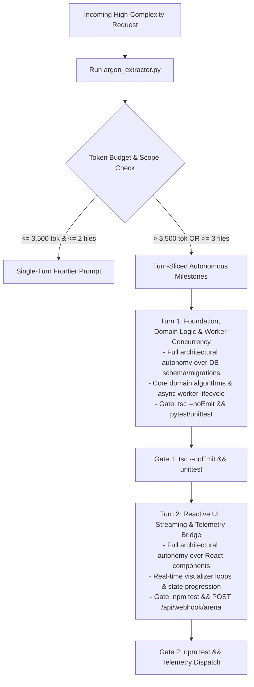

# Frontier Model Prompt Templates: Architectural Autonomy within Hard Invariants

This guide defines the official prompt engineering specifications for LM Arena Agentic Mode and frontier models (Claude Fable 5.2 Max, Claude Opus 5.5 Max, Gemini 4 Carbon, Gemini 4 Argon High).

---

## 0. Accessing Frontier Models: Capability Gating, Direct Selection & 60s Diagnostics

In blind Arena modes ([Start Voting](https://arena.ai/) and [Agent Arena](https://arena.ai/leaderboard/agent)), the router uses **pre-read weighted random sampling** to preserve benchmark impartiality ([Interaction-as-a-Judge](https://arena.ai/blog/interaction-as-a-judge/)). The router does *not* read prompt difficulty to award stronger models to harder tasks.

### 1. Capability Gating in Blind Agent Mode
To narrow the randomized routing pool exclusively to top-tier orchestrators, enforce technical filters that eliminate weaker endpoints *before* the sampling roll:
* **Enable Workspace Connectors**: Restricts routing pool to models certified for multi-tool schemas and authenticated connector pipelines.
* **Include Multimodal Inputs**: Attaching UI wireframes, architecture diagrams, or error screenshots drops text-only endpoints and forces selection of vision-to-code orchestrators.
* **Provide Multi-File / Structured Archives**: Filters out endpoints with narrow context windows or weak file-system tool harnesses.

### 2. Deterministic Flagship Selection (Bypassing Blind Routing)
When executing production work where randomized assignment cannot be risked:
* **Direct Model Selection**: Use [Choose any model](https://arena.ai/direct) to pick flagship models directly (`Claude Fable 5.2 Max`, `Claude Opus 5.5 Max`, `Gemini 4 Carbon`).
* **Side-by-Side Mode**: Use [Compare Models Side by Side](https://arena.ai/side-by-side) to evaluate two explicitly chosen frontier models simultaneously.

### 3. Early-Turn Diagnostics (The 60-Second Re-Roll Sentinel)
Evaluate model behavior during its first two tool calls:
* **Signals of High / Max Orchestrator**: Maps directory structure and reads configuration/test files *before* writing code; uses targeted searches (`grep`, `rg`, line-range reads); analyzes full stack traces on error.
* **Signals of Low / Medium Orchestrator**: Immediately starts writing or overwriting files without checking dependencies; repeats failing commands with minor syntax guesses; hallucinates paths.
* **The Re-Roll Rule**: If a blind session exhibits Low-tier thrashing in turns 1–2, **terminate immediately and open a fresh session to re-roll the orchestrator**.

---

## 1. LMSYS Max Router & Frontier Model Triggering Engine

LM Arena Agentic mode does NOT allocate top-tier frontier models based on prompt hype. Prompting with phrases like *"Act as a world-class engineer"* or *"Use your smartest model"* triggers Arena's **Steerability Penalty ($P_{\text{steer}}$)**, causing sessions to down-route to lightweight utility models.

### Why Over-Prescriptive Micromanagement Causes Down-Routing
When a prompt provides rigid, step-by-step pseudo-code ("Step 1: Open file X. Step 2: Add import Y. Step 3: Write function foo(a, b)..."):
1. **Collapses Reasoning Tree Depth to $O(1)$**: The prompt author has already solved the causal reasoning and architecture. The task degenerates into mechanical stenography and code transcription.
2. **Win-Rate Parity on Procedural Code**: LMSYS empirical preference data demonstrates that routine models (Astra Medium, Terra) achieve ~96–98% win-rate parity on rote code transcription at 1/10th the inference cost.
3. **Compute Over-Allocation Penalty ($P_{\text{script}}$)**: Allocating 64,000 extended thinking tokens (CoT) to transcribe a pre-solved script is penalized as economic over-allocation. The router down-routes the session to routine models.

### What Triggers Tier 1 Frontier Models
The router allocates Tier 1 Frontier models when the **Task Complexity Score (TCS)** spikes across 5 dimensions:
1. **Cross-Boundary Coupling ($S_{\text{cross}}$)**: Tasks spanning 2–3 coupled architectural tiers simultaneously (PostgreSQL RLS migrations $\leftrightarrow$ async worker daemon lifecycle $\leftrightarrow$ client React state machines $\leftrightarrow$ carrier/SIP encoding protocols).
2. **Abstract Invariant Density ($S_{\text{invariant}}$)**: High ratio of declarative system invariants (what must *never* break) vs imperative instructions (how to write it). Models must use deep CoT to satisfy all invariants simultaneously.
3. **High Semantic Signal-to-Noise Ratio**: Lean Type Spines (< 3,500 tokens) with AST interfaces, Zod schemas, and DB DDL (bodies stripped to `...`) without dumping raw codebase files.
4. **Deterministic Falsifiability ($S_{\text{verif}}$)**: Concrete container verification commands (`(cd web && npx tsc --noEmit)`, `npm test`, `pytest`). Weak models fail multi-file compilation; the router recognizes only frontier models achieve zero-defect pass rates.
5. **Explicit Architectural Freedom**: Explicitly delegating architectural ownership to the model forces the router to budget deep CoT search space rather than routine line generation.

---

## 2. The 5-Pillar Architectural Prompt Anatomy

Every prompt must adhere strictly to the 5-pillar structure delivered in **EXACTLY ONE COPYABLE BLOCK**:

```text
┌────────────────────────────────────────────────────────────────────────┐
│ Pillar 1: High-Complexity Multi-Tier Problem Statement                 │
│ - Defines real system objective coupling 2-3 distinct tiers            │
│ - Zero steerability hype ("elite", "world-class", "think step-by-step")│
├────────────────────────────────────────────────────────────────────────┤
│ Pillar 2: Minimal Ground-Truth Type Spine (< 3,500 tokens)             │
│ - AST-extracted interfaces, types, Zod schemas, DB DDL & CSS tokens    │
│ - Zero implementation bodies (...); 100% semantic contracts            │
├────────────────────────────────────────────────────────────────────────┤
│ Pillar 3: Non-Negotiable Contract & Safety Invariants                  │
│ - 4 to 6 declarative post-conditions and mathematical boundaries       │
│ - PostgreSQL RLS session authority, zero loose any, monotonic state    │
├────────────────────────────────────────────────────────────────────────┤
│ Pillar 4: Executable Deterministic Test Gates                          │
│ - Exact container shell commands: tsc --noEmit, npm test, unittest     │
├────────────────────────────────────────────────────────────────────────┤
│ Pillar 5: Explicit Architectural Freedom Grant                         │
│ - Standardized autonomy mandate delegating complete design ownership   │
└────────────────────────────────────────────────────────────────────────┘
```

### The Standardized Architectural Freedom Clause
Every prompt directive section must conclude with this cognitive ownership clause:
> *"You have complete architectural ownership of internal implementation details, state machines, memoization strategies, error recovery, and concurrency patterns. Design the optimal solution that satisfies all invariant boundaries and passes all verification gates."*

---

## 3. Production-Ready Frontier Agent Prompt Template (Mandatory 3-Phase Protocol)

For Agent Mode tasks (`arena.ai/agent`), wrap assignments in this production template:

```markdown
## Objective
[State the exact deliverable, target system, and end-user behavior in 2–3 sentences.]

## Inputs & Attached Context
- Attached Artifact / Connector: [Reference your uploaded screenshot, diagram, repo archive, or active Connector]
- Constraint: You must inspect and extract all specifications from the attached artifact/connector before proposing changes.

## Execution Protocol (Mandatory Phases)

### Phase 1: Environment Audit (Read-Only)
1. Inspect the workspace structure, package dependencies, and relevant existing modules using targeted search commands (`grep`, `rg`, line-range reads; do not dump lockfiles or build folders).
2. Identify potential edge cases, version conflicts, or architectural constraints.
3. Output a concise implementation plan mapping exact files to create or modify.
*Constraint: Do NOT write or edit any files until Phase 1 is complete.*

### Phase 2: Implementation
1. Implement the solution modularly, matching existing project conventions and strict typing.
2. Handle error states, input validation, and edge cases explicitly—no placeholder logic or TODO stubs.
3. You have full architectural ownership of internal implementation details, state machines, and concurrency patterns.

### Phase 3: Verification & Self-Correction
1. Run the build, type-checker, and test suite:
   - `(cd web && npx tsc --noEmit)`
   - `npm test`
   - `(cd agent-worker && .venv/bin/python -m unittest discover -s tests)`
2. If any command fails, analyze the full error trace, explain the root cause, and patch it cleanly.
3. Do not conclude until all verification checks pass with zero errors.
```

---

## 4. Mid-Session Steering Strategy (Interaction-as-a-Judge Optimization)

Arena tracks **Steerability, Confirmed Success, Bash Recovery, and Tool Hallucination**:
* **Replace Vague Pushback with Diagnostic Constraints**: Instead of *"That didn't work, fix it"*, write: *"The build failed with `[exact error]` because `[module X]` expects `[type Y]`. Inspect `[file]` lines 40–80 before applying a patch."*
* **Explicitly Confirm Milestone Completion**: When Phase 1 or Phase 2 succeeds, state: *"Phase 1 verified—proceed to Phase 2."* This locks in the valid state and prevents the agent from rewriting working code.
* **Isolate Failing Sub-Tasks**: If an agent gets stuck on a complex integration, pause and instruct it: *"Write a standalone minimal reproduction script in `/tmp/test_repro.ts` to verify the behavior before touching the main codebase."*

---

## 3. Autonomous Turn-Slicing Protocol (< 3,500 Token Budget)

When an assignment requires generating over 300 lines of implementation across multiple boundaries, Antigravity slices the task into **Autonomous Architectural Milestones** rather than procedural step lists:



---

## 4. Canonical Production-Grade Templates

### Template 1: Real-Time Telephony, LiveKit SIP & Worker Concurrency

````markdown
### Target Repository & Branch
- Repository: `gagandeepsinghrajput575-cloud/nordic-omni` (`main`)
- Active Branch: `feat/telephony-sip-hardening`

### 1. High-Complexity Multi-Tier Problem Statement
Design and implement an end-to-end resilient Danish telephony ingress and live call routing architecture coupling three systems:
1. **LiveKit SIP Inbound Ingress (`agent-worker/main.py`, `agent-worker/services/call_slots.py`)**: Real-time voice session dispatch, VAD barge-in with Azure TTS (`da-DK-ChristelNeural`), bounded concurrency via `CallSlotRegistry`, and ordered asynchronous shutdown teardown.
2. **PostgreSQL Multi-Tenant DID Routing (`db/migrations/0008_sip_inbound_routing.sql`)**: Normalized E.164 FlyNumber DID resolution mapping incoming PSTN numbers directly to tenant accounts without fallback leakage.
3. **Telephony State Machine & Contracts (`web/src/contracts/schemas.ts`)**: Monotonic call lifecycle progression preventing invalid state reversals across concurrent WebRTC events.

### 2. Extracted Ground-Truth Type Spine (< 3,500 tokens)

```python
# agent-worker/services/call_slots.py (AST interface)
class CallSlotRegistry:
    def __init__(self, limit: int) -> None: ...
    @property
    def active_count(self) -> int: ...
    @property
    def limit(self) -> int: ...
    def acquire(self, job_id: str) -> bool: ...
    def release(self, job_id: str) -> bool: ...
```

```typescript
// web/src/contracts/schemas.ts (AST contracts)
export const CallStatusSchema = z.enum([
  'ringing',
  'in_progress',
  'dire_hold_for_owner',
  'owner_consulting_ai',
  'merged_live_with_owner',
  'ai_relaying_owner_instruction',
  'completed',
  'missed',
]);
export type CallStatus = z.infer<typeof CallStatusSchema>;
```

```sql
-- db/migrations/0008_sip_inbound_routing.sql
CREATE UNIQUE INDEX IF NOT EXISTS idx_tenants_flynumber_did_normalized
    ON tenants (((CASE WHEN regexp_replace(flynumber_did, '[^0-9]', '', 'g') LIKE '00%'
        THEN '+' || substr(regexp_replace(flynumber_did, '[^0-9]', '', 'g'), 3)
        ELSE '+' || regexp_replace(flynumber_did, '[^0-9]', '', 'g') END)))
    WHERE flynumber_did IS NOT NULL;
```

### 3. Non-Negotiable Contract & Safety Invariants
1. **Concurrency Ceiling**: `CallSlotRegistry` must strictly enforce `active_count <= limit`. Spurious or duplicate `release()` calls must be idempotent and must never decrement below zero or corrupt slot state under concurrent async tasks.
2. **Deterministic Teardown**: In `agent-worker/main.py`, slot release and socket cleanup must execute deterministically under an `asyncio.Lock` inside the `finally` block of `entrypoint()`, guaranteeing zero resource leaks even if connection initialization or Azure TTS fails.
3. **DID Normalization Parity**: PSTN phone numbers formatted with Danish local (8 digits), international (`+45`), or trunk (`0045`) prefixes must resolve deterministically to the unique normalized E.164 format.
4. **Monotonic Call Lifecycle**: Transitions in `CallStatusSchema` must be strictly monotonic. Once marked `completed` or `missed`, a call must never transition back to `in_progress` or `ringing`.
5. **Zero Type Escapes**: All TypeScript code must compile with zero errors and zero loose `any` casts.

### 4. Executable Test Gates
Verify your implementation in the container by executing:
- `(cd web && npx tsc --noEmit)`
- `npm test`
- `(cd agent-worker && .venv/bin/python -m unittest discover -s tests)`

### 5. Architectural Autonomy Grant
You have complete architectural ownership of internal implementation details, state machines, memoization strategies, error recovery, and concurrency patterns. Design the optimal solution that satisfies all invariant boundaries and passes all verification gates.

### Required Final Output: Cockpit Arena Evaluation Payload
Conclude your response with the exact evaluation payload for `POST http://localhost:4000/api/webhook/arena`:
```json
{
  "model": "<evaluated-model-name>",
  "category": "telephony-sip-and-worker-concurrency",
  "score": 0.0,
  "verdict": "<PASS/FAIL with exact observed test results>",
  "experience": "<files modified, verified invariants, and command outputs>",
  "snippet": "<core hardened logic snippet>"
}
```
````

---

### Template 2: Dual-Runtime Domain Parity, PostgreSQL RLS & Carrier SMS Dispatch

````markdown
### Target Repository & Branch
- Repository: `gagandeepsinghrajput575-cloud/nordic-omni` (`main`)
- Active Branch: `feat/danish-sms-rls-parity`

### 1. High-Complexity Multi-Tier Problem Statement
Implement an end-to-end, multi-tenant Danish post-call SMS dispatch and catalog estimation system that enforces strict isolation and calculation parity across runtimes:
1. **Multi-Tenant Security & PostgreSQL RLS (`db/migrations/0013_public_contact_rls_and_tenant_integrity.sql`, `web/src/app/api/telephony/sms/route.ts`)**: Tenant authority must be derived exclusively from verified session tokens (`apiSession()`), preventing cross-tenant injection or caller-supplied tenant spoofing.
2. **Carrier SMS Segment Engine (`web/src/lib/sms.ts`, `web/src/contracts/schemas.ts`)**: Carrier dispatch accounting supporting both GSM 03.38 7-bit encoding (including Danish letters `æ`, `ø`, `å`) and UCS-2 multi-segment fallback for Unicode/emoji payloads.
3. **Dual-Runtime Estimation Parity (`agent-worker/agents/estimation.py`, `web/src/lib/calculator.ts`)**: Mathematical pricing and midpoint rounding parity between Python (half-to-even) and TypeScript (half-up) with zero floating-point drift.

### 2. Extracted Ground-Truth Type Spine (< 3,500 tokens)

```typescript
// web/src/contracts/schemas.ts
export const SmsMessageTypeSchema = z.enum([
  'customer_followup',
  'lead_alert',
  'inspection_confirm',
  'custom',
]);

export const SmsStatusSchema = z.enum(['queued', 'sending', 'delivered', 'failed']);

export const SmsDispatchRecordSchema = z.object({
  id: z.string(),
  recipient: z.string(),
  messageType: SmsMessageTypeSchema,
  body: z.string(),
  callLogId: z.string().nullable(),
  contactId: z.string().nullable(),
  workspaceId: z.string(),
  workspaceName: z.string(),
  status: SmsStatusSchema,
  carrier: z.string(),
  segments: z.number().int().positive(),
  deliveryLatencyMs: z.number().int().nonnegative(),
  createdAt: z.string(),
  error: z.string().optional(),
});

export const SmsSendRequestSchema = z.object({
  recipient: z.string().min(1),
  messageType: SmsMessageTypeSchema.optional().default('custom'),
  body: z.string().optional(),
  callLogId: z.string().nullable().optional(),
  contactId: z.string().nullable().optional(),
  workspaceId: z.string().optional(),
});
```

```sql
-- db/migrations/0013_public_contact_rls_and_tenant_integrity.sql
ALTER TABLE contacts ENABLE ROW LEVEL SECURITY;
CREATE POLICY tenant_isolation_contacts ON contacts
    FOR ALL USING (tenant_id = current_setting('app.current_tenant_id', true)::uuid);
```

### 3. Non-Negotiable Contract & Safety Invariants
1. **Session-Derived Tenancy**: The SMS dispatch route handler must derive tenant context strictly from the authenticated session. Requests attempting to supply an external tenant ID must fail with an invariant violation.
2. **GSM 03.38 & UCS-2 Encoding Accuracy**: Messages composed strictly of GSM 03.38 characters (including Danish `æ, ø, å`) must allocate 160 characters for single segment, and 153 characters per segment for multi-part messages. Any payload containing characters outside GSM 03.38 must immediately switch to UCS-2 boundaries (70 chars single, 67 chars multi-part).
3. **Dual-Runtime Mathematical Parity**: Currency and midpoint rounding between Python worker calculations and TypeScript web representations must achieve 100% agreement on test vectors.
4. **Type Soundness**: Zero loose `any` casts, zero unchecked type assertions (`as Type`), and 100% validation coverage via Zod schemas.

### 4. Executable Test Gates
Verify your implementation in the container by executing:
- `(cd web && npx tsc --noEmit)`
- `npm test`
- `(cd agent-worker && .venv/bin/python -m unittest discover -s tests)`

### 5. Architectural Autonomy Grant
You have complete architectural ownership of internal implementation details, state machines, memoization strategies, error recovery, and concurrency patterns. Design the optimal solution that satisfies all invariant boundaries and passes all verification gates.

### Required Final Output: Cockpit Arena Evaluation Payload
Conclude your response with the exact evaluation payload:
```json
{
  "model": "<evaluated-model-name>",
  "category": "dual-runtime-parity-and-sms-rls",
  "score": 0.0,
  "verdict": "<PASS/FAIL with exact observed test results>",
  "experience": "<files modified, verified invariants, and command outputs>",
  "snippet": "<hardened RLS route or GSM segmentation snippet>"
}
```
````

---

### Template 3: High-Fidelity Client Experience, Audio Visualizer & Real-Time Telemetry

````markdown
### Target Repository & Branch
- Repository: `gagandeepsinghrajput575-cloud/nordic-omni` (`main`)
- Active Branch: `feat/audio-visualizer-telemetry`

### 1. High-Complexity Multi-Tier Problem Statement
Engineer a high-performance, accessible real-time WebRTC audio visualization interface and telemetry bridge coupling:
1. **Web Audio API & Visualizer RAF Loop (`web/src/components/audio/OrbVisualizer.tsx`)**: High-FPS frequency-domain visualization that dynamically paces frames, manages Web Audio API context lifecycles, and executes clean disposal on unmount without leaking audio descriptors or RAF handles.
2. **Public Call State Machine (`web/src/app/call/[contactId]/CallClientView.tsx`)**: Finite state orchestration (`idle`, `connecting`, `active`, `reconnecting`, `error`, `ended`) resilient to unexpected network disconnects and WebRTC track dropouts.
3. **Design System & Accessibility Invariants (`web/src/app/globals.css`)**: Warm Nordic editorial palette adhering strictly to CSS design tokens with full WCAG 2.2 AA compliance and `prefers-reduced-motion` static fallbacks.
4. **Cockpit Telemetry Bridge (`cockpit/server.js`)**: Real-time evaluation telemetry dispatch reporting call metrics to the Cockpit controller.

### 2. Extracted Ground-Truth Type Spine & Design Tokens (< 3,500 tokens)

```css
/* web/src/app/globals.css */
:root {
  --bg: #FAF7F2;
  --panel: #fffdf9;
  --text: #1C1512;
  --muted: #6E6259;
  --border: rgba(44, 34, 28, 0.12);
  --a: #7C3AED;
  --accent: #2563EB;
}
```

```typescript
// Extracted component interfaces
export interface OrbVisualizerProps {
  mediaStream: MediaStream | null;
  isActive: boolean;
  size?: number;
  className?: string;
  onAnalysisUpdate?: (rms: number) => void;
}

export type CallConnectionState = 
  | 'idle' 
  | 'requesting_media' 
  | 'connecting' 
  | 'active' 
  | 'reconnecting' 
  | 'ended' 
  | 'failed';
```

### 3. Non-Negotiable Contract & Safety Invariants
1. **Idempotent Resource Teardown**: Component unmounting or track replacement must deterministically close the `AudioContext`, disconnect all analyser nodes, and cancel pending `requestAnimationFrame` IDs without throwing runtime exceptions.
2. **Zero Magic Styling Values**: All colors, borders, and transitions must reference existing `:root` design tokens. Magic hex values and ad-hoc Tailwind arbitrary values (`text-[12.5px]`) are prohibited.
3. **Accessibility & Reduced Motion**: When `prefers-reduced-motion: reduce` is active, the visualizer must immediately cancel continuous RAF oscillation and transition to an accessible, static SVG representation.
4. **State Machine Integrity**: Connection failures must never leave the UI in a fake "active" state; the state machine must transition deterministically to `failed` and display actionable user feedback.
5. **Zero Type Escapes**: Must pass TypeScript compiler validation with zero errors and zero loose `any` casts.

### 4. Executable Test Gates
Verify your implementation in the container by executing:
- `(cd web && npx tsc --noEmit)`
- `npm test`

### 5. Architectural Autonomy Grant
You have complete architectural ownership of internal implementation details, state machines, memoization strategies, error recovery, and concurrency patterns. Design the optimal solution that satisfies all invariant boundaries and passes all verification gates.

### Required Final Output: Cockpit Arena Evaluation Payload
Conclude your response with the exact evaluation payload:
```json
{
  "model": "<evaluated-model-name>",
  "category": "audio-visualizer-and-client-telemetry",
  "score": 0.0,
  "verdict": "<PASS/FAIL with exact observed test results>",
  "experience": "<files modified, verified invariants, and command outputs>",
  "snippet": "<hardened RAF teardown or state machine snippet>"
}
```
````

---

## 5. Anti-Pattern Checklist: Purging Handcuffs & Down-Routing Triggers

When auditing or generating prompts, ensure none of the following down-routing triggers are present:

| Anti-Pattern (Down-Routing Trigger) | Why It Causes Down-Routing | Required Replacement Pattern |
|---|---|---|
| **Step-by-step procedural pseudo-code** ("Step 1 do this, Step 2 do that") | Pre-solves the logic, collapsing reasoning tree depth ($S_{\text{depth}}$) to $O(1)$ and triggering the Micromanagement Penalty ($P_{\text{script}}$). | **High-Complexity Multi-Tier Problem Statement** + **Explicit Architectural Freedom Grant**. |
| **Steerability Hype** ("Act as an elite 10x architect", "Use maximum genius") | Triggers Arena's Steerability Penalty ($P_{\text{steer}}$) and results in session downgrades to cheap models. | **Objective, high-density technical specifications** describing real invariants and domain complexities. |
| **Raw Repository Code Dumps** (>10,000 tokens) | Triggers Context Bloat Penalty ($P_{\text{bloat}}$), DOM freezes in web client, and dilutes attention heads. | **Surgical Type Spine (< 3,500 tokens)** extracted via AST tools with function bodies stripped to `...`. |
| **Vague or Missing Verification** ("Please test your code") | Fails to signal deterministic falsifiability ($S_{\text{verif}}$) to the router. | **Concrete container shell commands** (`(cd web && npx tsc --noEmit)`, `npm test`, `pytest`). |
| **Single-File Trivial Helpers** | Low cross-boundary complexity ($S_{\text{cross}}$) signals a task suitable for routine utility models. | **Multi-tier problem formulation** coupling database, transport, and client layers simultaneously. |

---

## 6. Template E: The 4-to-8 Hour Autonomous Marathon Protocol

Use this template when delegating large multi-hour engineering missions (e.g. implementing full sub-systems, refactoring entire tiers, or continuous test-hardened feature builds) to LM Arena agents under external monitoring by Antigravity.

```markdown
## Objective: Long-Running Autonomous Marathon Execution
[State high-level goal, e.g.: "Implement the complete multi-tenant Feature Switchboard, Meta Ads Campaign Manager, and AI SEO (GEO) citation engine across database, API routes, and client portal."]

## Connected Environment & Tooling
- Integration: Google Drive Connector is active (Folder: `skillgods`).
- Mandatory Guides: Read `CHIEF_SOFTWARE_ENGINEER_CHECKLIST.md` and `arena-context-compactor.md` from Google Drive before beginning.
- Continuous Oversight: Antigravity Chief Software Engineer is monitoring outputs and validating test suites.

## Mandatory Autonomous Epoch Loop Protocol
You are running in Autonomous Marathon Mode. You are NOT permitted to stop after completing a single file or sub-task. You must execute continuous work cycles until the entire task backlog is 100% complete and verified.

### Epoch Step 1: Backlog Initialization (Turn 1)
1. Inspect the workspace and create/initialize `TASKS.json` in the root with 15–30 granular, sequential micro-tasks covering the entire objective.
2. Initialize `PROGRESS.md` and `LESSONS.md` on disk.
3. Update `skillgods/STATE.md` with the active mission plan.

### Epoch Step 2: The Continuous Execution Loop
For EACH task in `TASKS.json` with status `pending`:
1. **Targeted Read**: Read ONLY the specific files and tests needed for this task. Check `LESSONS.md` for known pitfalls.
2. **Red-Green TDD**: Write or update failing automated unit/integration tests first.
3. **Surgical Implementation**: Write the minimal typed production code to make the tests pass. No placeholders, no `as any`, no synthetic styling.
4. **Deterministic Verification Gate**:
   - Run: `(cd web && npx tsc --noEmit)`
   - Run: `npm test`
5. **On Verification Pass**:
   - Stage and commit: `git add . && git commit -m "feat([scope]): [task title]"`
   - Mark task as `completed` in `TASKS.json`.
   - Append a 2-line summary to `PROGRESS.md`.
6. **On Verification Fail**:
   - Revert dirty changes: `git checkout -- .`
   - Log the failure reason into `LESSONS.md` to prevent repeating it.
   - Adjust hypothesis and retry once.
7. **Attention Pruning (Context Compaction)**:
   - Search Google Drive for `arena-context-compactor.md`.
   - Prune intermediate terminal dumps from your active memory.
   - Update `skillgods/STATE.md`.
   - **DO NOT STOP**. Immediately proceed to the next pending task in `TASKS.json`.

### Epoch Step 3: Mission Completion & Final Deliverable
Only when ALL tasks in `TASKS.json` are marked `completed` and all tests pass (0 failures, 0 TypeScript errors):
1. Download the cumulative git patch: `git diff main...HEAD > marathon_deliverable.patch`.
2. Output the final summary report with total tasks completed, passing test count, and list of modified files.
```
